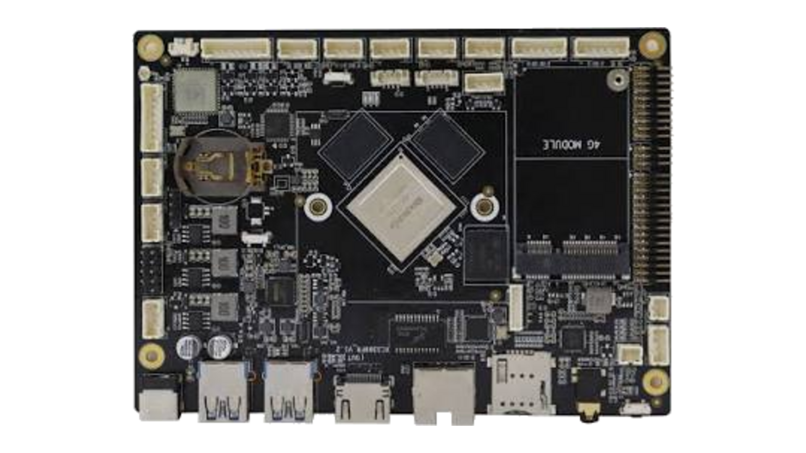

# Armbian for the Xiangcheng XC3399FR v1.1a

<p align="center">
  
</p>

A production-ready [Armbian](https://www.armbian.com/) board port for the
**Xiangcheng XC3399FR v1.1a** industrial single-board computer
([proembed.com](https://www.proembed.com/)) — a Rockchip **RK3399** board with
4 GB LPDDR4, eMMC, gigabit Ethernet, dual USB 3.0, HDMI and onboard Wi-Fi/BT.

**The board is part of Armbian.** The port was merged upstream on 2026-09-06
([armbian/build#10619](https://github.com/armbian/build/pull/10619) and
[armbian.github.io#440](https://github.com/armbian/armbian.github.io/pull/440)),
so Armbian builds and publishes rolling images for it directly. This repository
is what remains: a thin
[userpatches](https://docs.armbian.com/Developer-Guide_Using-Git/#the-userpatches-directory)
overlay carrying the handful of choices that are specific to the units we ship,
plus the hardware documentation and tooling — **nothing in Armbian is forked or
modified**. A GitHub Actions workflow builds a flashable image on every change.

> **Status:** hardware-validated. Boots from SD, eMMC, or eMMC-bootloader +
> USB-SSD-rootfs. Every advertised interface has been exercised on a real board.
> See [Verified](#verified-on-hardware).

---

## Quick start

1. Get an image. Two sources, both valid:
   * **This repository** — the latest `*.img.xz` from the
     [Releases](../../releases) page (or the artifact of the newest
     [Actions](../../actions) run). Pinned framework, `current` kernel only,
     watchdog enabled. This is what ships on units we sell.
   * **Armbian's own build** — `Armbian_community_*_Xc3399fr_*` from
     [armbian/community releases](https://github.com/armbian/community/releases)
     or the board's armbian.com download page. Stock, unpinned, offers a desktop
     variant. See [Upstream status](#upstream-status) for availability.

   Verify whichever you take against its `.sha`.
2. Flash it to a micro-SD card with [Etcher](https://etcher.balena.io/) or
   Raspberry Pi Imager.
3. Insert the card and power the board. First boot resizes the rootfs and asks
   you to set a root password and create a user.
4. The board is reachable over SSH (its DHCP lease) and on the debug UART at
   **1500000 baud, 8N1** (console `ttyS2`).

### Move the system onto a USB SSD (recommended for 24/7 use)

Boot once from SD, then run the **stock** installer:

```bash
sudo armbian-install
```

Pick your USB SSD as the target and choose
**“Boot from eMMC, system on this disk (+ /emmc_storage)”**. Remove the SD card
and reboot — U-Boot and `/boot` stay on the eMMC, the root filesystem runs from
the SSD. No manual fix-up is needed (see [Design notes](#why-bootscr-and-not-extlinux)).

> ⚠️ **Plug the SSD into the `fe900000.usb` port.** The two USB3 ports do not
> behave the same with a bus-powered 2.5″ disk: on `fe800000.usb` a disk logged
> 125 disconnect events in one session while a disk on `fe900000.usb` logged 1.
> Why is not established — see [`docs/storage.md`](docs/storage.md) — but the
> rule holds. Confirm at runtime:
> ```bash
> readlink -f /sys/class/block/sda/device | grep -oE 'fe[89]00000\.usb'
> # fe900000.usb = use this   |   fe800000.usb = do not put a disk here
> ```
> Mark the good port on the enclosure before shipping units.

---

## Hardware

The vendor datasheet is wrong on several points; this table is what the board
actually is, measured over the debug UART.

| | Datasheet | Actual |
|---|---|---|
| SoC | RK3399 | RK3399 (hexa-core A72×2 + A53×4) |
| RAM | DDR3 2 GB | **LPDDR4 4 GB** (2×2048 MB @ 856 MHz) |
| eMMC | 16 GB | 14.6 GiB, **HS400 Enhanced Strobe** (~267 MB/s) |
| Ethernet | — | **RTL8211E** gigabit PHY, RGMII |
| Wi-Fi / BT | — | **AP6256** (BCM4345/9), Wi-Fi 5 + **BT 5.0** |
| “4× RS232” | UART | **Exar XR21V1414** USB-serial bridge → `/dev/ttyUSB0-3` |
| Debug UART | (missing) | UART2 `0xff1a0000`, **1500000 baud** |
| mini-PCIe | “3G/4G” | No usable PCIe (PHY PLL never locks); USB-signalled 4G modem only |
| mSATA | — | **Not possible** — RK3399 has no SATA controller |

Full pin-level notes: [`docs/hardware.md`](docs/hardware.md).

## Verified on hardware

| Feature | Result |
|---|---|
| USB 3.0 × 2 | both ports enumerate SuperSpeed 5000M |
| HDMI | connected, EDID, up to 2560×1440, HDMI audio |
| Gigabit Ethernet | 1000M full-duplex, 0 errors across 4 GB / iperf |
| micro-SD | SDR50 @ 100 MHz (1.8 V signalling) |
| eMMC | HS400 Enhanced Strobe, ~267 MB/s |
| Wi-Fi | scans, associates (BCM4345/9, fw 7.45.96.2) |
| Bluetooth | BCM4345C5, **BT 5.0** |
| USB-SSD rootfs | 251 MB/s read, boots via eMMC bootloader |
| Hardware watchdog | `/dev/watchdog0` active, systemd-fed at 30 s |
| Thermals | peak 83.9 °C under full stress, no throttling |
| Stability | 6 h+ continuous eMMC+SSD run: 0 disconnects, 0 I/O errors |

## What this port changes vs a generic RK3399 config

The device tree is derived from `rk3399-fine3399.dts` and verified against real
hardware over the debug UART. A vendor Android device tree, dumped from an
XC3399FR of a **different hardware revision**, was used as a cross-check only —
never as the sole justification for a change. Highlights:

- **Second USB 3.0 port revived** — `vcc5v0_host`/`vcc5v0_otg` regulators drive
  the VBUS-enable GPIOs the generic config leaves floating; removed the
  `st7735r` panel node that was holding one of them low.
- **Bluetooth fixed** — `brcm,bcm4345c5` at 1.5 Mbaud (BT 5.0 now works).
- **Ethernet RGMII skew** tuned to this board (`tx_delay`/`rx_delay`).
- **PCIe disabled** — no PCIe is routed; stops the `-110` probe noise each boot.
- **Correct fan, LEDs, backlight, 4G-slot power, UART4.**
- **Removed reference-board junk** — HYM8563 RTC (proven absent by I²C scan),
  RT5640 codec, GT911 touch, IR receiver.
- **micro-SD UHS modes** advertised so a fast card runs at SDR50 instead of
  falling back to 50 MHz high-speed.
- **Hardware watchdog handed to systemd** (`RuntimeWatchdogSec=30s`) for
  unattended 24/7 operation.

The device tree now lives upstream. The full annotated source is
[`patch/kernel/archive/rockchip64-6.18/dt/rk3399-xc3399fr.dts`](https://github.com/armbian/build/blob/main/patch/kernel/archive/rockchip64-6.18/dt/rk3399-xc3399fr.dts)
in `armbian/build`; every non-obvious value carries an in-tree comment
explaining the evidence.

## Why boot.scr and not extlinux

`fine3399` — which this config was derived from — is one of only 22 of Armbian’s
362 boards that boot via `extlinux.conf`. That breaks the eMMC-boot + USB-root
scenario: `armbian-install` only knows how to rewrite `armbianEnv.txt`, and
`extlinux.conf` uses absolute paths that are correct when `/boot` is a directory
(SD card) but wrong when `/boot` is its own partition (eMMC), so U-Boot can’t
find the initrd and loops into PXE — the classic *“stops after U-Boot, SSD LED
never lights.”*

This port therefore **does not** set `SRC_EXTLINUX="yes"`, so the board uses
`boot.scr` + `armbianEnv.txt` like the other 340 boards. The rockchip64 boot
script addresses every file through `${prefix}`, which U-Boot resolves from
`boot_prefixes="/ /boot/"` for whichever layout it finds — so a single
`boot.scr` boots correctly whether `/boot` is a directory or a partition, always
appends `rootwait`, and exposes `usbstoragequirks` as a first-class variable.
Result: the stock `armbian-install` split-emmc flow just works.

Details: [`docs/install.md`](docs/install.md).

---

## Building it yourself

### In CI (recommended)

Push to `main`, or run the **Build Armbian image (XC3399FR)** workflow manually
from the Actions tab. Every successful build:

- uploads the image as a build **artifact**, and
- publishes it to the rolling **[`latest`](../../releases/tag/latest)**
  pre-release, so a downloadable `.img.xz` is always one click away.

Tagging `vX.Y.Z` (`git tag v1.0.0 && git push origin v1.0.0`) publishes an
immutable, release-noted version.

> **Maintaining or extending this port?** Read
> **[`docs/development.md`](docs/development.md)** — the complete, self-contained
> guide to building, changing the device tree safely, testing on hardware,
> the CI/release flow, and every non-obvious gotcha.

### Locally

Requires a Debian/Ubuntu host (or WSL2) with ~30 GB free. The build overlays
this repo’s `userpatches/` onto a pinned Armbian checkout:

```bash
git clone https://github.com/armbian/build armbian-build
cd armbian-build
git checkout 66dbc7af2a77d52ccd3fe2156a55687622848ea3     # pinned; see the workflow
cp -r ../armbian-xc3399fr/userpatches/. userpatches/
./compile.sh build \
  BOARD=xc3399fr BRANCH=current RELEASE=trixie \
  BUILD_MINIMAL=yes BUILD_DESKTOP=no KERNEL_CONFIGURE=no \
  COMPRESS_OUTPUTIMAGE=sha,xz
```

On a RAM-constrained host cap parallelism with `CPUTHREADS=6` to avoid the OOM
killer during the kernel compile.

## Repository layout

```
userpatches/
  config/boards/xc3399fr.csc                product overlay: KERNEL_TARGET + watchdog hook
.github/workflows/build-image.yml           CI/CD: build + release
docs/
  storage.md                                USB-SATA bridge, UAS vs BOT, all measurements
  upstream.md                               what is upstream vs what stays here
  install.md                                boot on eMMC + system on USB SSD, customer flow
  hardware.md                               pin-level hardware notes
  testing.md                                how to reproduce every measurement
  development.md                            maintainer/dev guide (read this first)
  reference/
    rk3399_android_vendor.dts.txt           vendor Android DT (cross-check only, see note)
    rk3399-xc3399fr.reference.dtb           prebuilt DTB for comparison
tools/
  serial/                                   UART login, logging, U-Boot access
  board/                                    on-board benchmark / transport / install helpers
```

The board config and the device tree are **no longer duplicated here** — they
live in `armbian/build` since #10619 merged. Armbian sources the upstream board
file first and this repo's `userpatches` copy second, so the overlay only needs
to carry what differs for the units we ship.

Start with **[docs/upstream.md](docs/upstream.md)** for the split between this
repository and Armbian, and **[docs/storage.md](docs/storage.md)** for the
storage decision — the one choice that most affects how these units behave in
the field.

## Upstream status

**Merged.** The board is part of Armbian as of 2026-09-06.

| PR | Contents | State |
|---|---|---|
| [armbian/build#10619](https://github.com/armbian/build/pull/10619) | board config + device trees for rockchip64 6.18 / 7.2 / 7.3 | **merged** 2026-09-06, commit [`66dbc7af`](https://github.com/armbian/build/commit/66dbc7af2a77d52ccd3fe2156a55687622848ea3) |
| [armbian/armbian.github.io#440](https://github.com/armbian/armbian.github.io/pull/440) | board photo + ProEmbed vendor logo | **merged** 2026-09-06 |

Because the board is a `.csc` (community-maintained) config, Armbian builds and
publishes rolling images for it automatically — no further action is needed to
get an official download. Boards merged shortly before this one took **6–9 days**
from merge to their first published image, so the first official
`Armbian_community_*_Xc3399fr_*` build is expected around **2026-09-12 to
2026-09-15**, in the [`armbian/community`](https://github.com/armbian/community/releases)
releases and on the board's armbian.com download page.

Building this repository's own image stays useful regardless: it is pinned,
reproducible, ships `current` only, and carries the watchdog hook.

## Scope

**In scope and done:** boot from SD / eMMC / eMMC-bootloader + USB-SSD rootfs,
Ethernet, Wi-Fi, Bluetooth, HDMI (incl. audio), USB 3.0, eMMC HS400 ES, micro-SD
UHS, fan, LEDs, watchdog, thermals.

**Out of scope — deliberately not supported:** LVDS output via the TC358775
DSI-to-LVDS bridge, MIPI camera, and analog audio. None are fitted or needed on
the units this port exists for. The RT5640 codec, HYM8563 RTC and GT911 touch
controller in the vendor device tree were proven absent on this hardware and are
removed on purpose; do not re-add them without an I²C probe that answers.

**Still open:** a longer multi-day soak of the USB-SSD path, and the cable/port
swap test described in [`docs/storage.md`](docs/storage.md).

## License

The device tree carries Armbian’s `GPL-2.0-or-later OR MIT` header. Everything
else in this repository is released under **GPL-2.0-or-later** to match the
Armbian build framework. See [LICENSE](LICENSE).

Not affiliated with or endorsed by Armbian or Guangzhou Xiangcheng Electronics.
